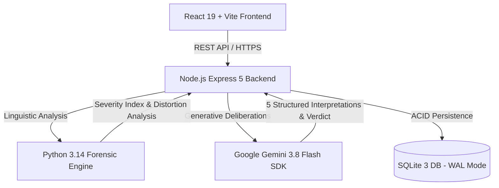

# PROJECT OVERTHINK — AI Forensic Bureau & Speculation Court

> **"One message. A thousand possibilities. Serious investigations. Hilarious conclusions."**

A complete, production-grade, deployment-ready AI application that analyzes ambiguous, dry, or anxiety-inducing messages through dual-engine forensic linguistics (Node.js + Python + Google Gemini AI).

---

## 🏛️ System Architecture



### 1. Dual-Engine Intelligence
- **Google Gemini 3.8 Flash** (`@google/genai`): Powers the 5 structured linguistic interpretations, prosecution/defence courtroom arguments, and the judicial verdict.
- **Python Forensic Linguistic Engine** (`python/forensic_analyzer.py`): Quantifies the Overthinking Severity Index (0–100%), detects cognitive distortions (Catastrophizing, Mind Reading, Fortune Telling, Personalization), calculates reality probabilities, and curates iconic internet memes.

### 2. High Judicial Court of Speculation & Facility Departments
Strictly gated judicial flow:
1. **Lobby & Meme Marquee (`/`)**: Teaser landing page featuring dual opposing viral meme streams and humorous incident presets that direct into Reception.
2. **Reception / Submission (`/investigate`)**: User files the ambiguous communication, context, and specific anxieties.
3. **Forensic Decode Lab (`/decode`)**: 5 structured interpretations (Optimistic, Neutral, Pessimistic, Absurd, Empirical) + Python linguistic distortions + Differentiated Response Playbook.
4. **The Courtroom (`/courtroom`)**: Interactive Witness Stand cross-examination under oath, followed by Prosecution, Defence, and the Supreme Judge's final ruling.
5. **Reality Check Matrix (`/reality-check`)**: Empirical facts vs. unsupported assumptions, cognitive grounding score, and proportionate actions.
6. **Therapy De-escalation Lounge (`/therapy-chat`)**: Real-time post-trial CBT counseling with live Gemini AI.
7. **Global Emotion Meter Telemetry (`EmotionMeterHUD`)**: Floating ambient monitor tracking Cortisol/Panic levels, Catastrophe index, and 4-7-8 somatic breathing across the whole experience.

---

## 🚀 Quick Start

### Prerequisites
- **Node.js** v20+ (tested on v24)
- **Python** 3.11+ (tested on v3.14)

### 1. Environment Configuration
Copy `.env.example` to `.env`:
```env
PORT=3001
GEMINI_API_KEY=your_gemini_api_key_here
GEMINI_MODEL=gemini-3.8-flash
```

### 2. Install Dependencies
```bash
# Install Node dependencies
npm install

# Initialize Python Virtual Environment & dependencies (optional for local metrics)
python -m venv .venv
.\.venv\Scripts\pip install -r requirements.txt
```

### 3. Run Locally
```bash
# Build frontend bundle
npm run build

# Start production server
node server.js
```
The application will be live at `http://localhost:3001`.

---

## 🔒 Security & Database Specification

### Database Architecture
- **Engine**: SQLite 3 using `better-sqlite3` compiled with high-performance C bindings.
- **Concurrency**: Write-Ahead Logging (`journal_mode = WAL`) enables non-blocking concurrent reads during writes.
- **Relational Integrity**: `foreign_keys = ON` with `ON DELETE CASCADE` ensures clean teardowns without orphaned trial or share records.
- **SQL Injection Prevention**: 100% of database interactions execute through parameterized prepared statements (`db.prepare(...)`).
- **High-Efficiency Indexes**:
  - `idx_cases_token` on `cases(access_token)`
  - `idx_cases_created` on `cases(created_at)`
  - `idx_trials_case` on `courtroom_trials(case_id)`
  - `idx_shares_case` on `shareable_verdicts(case_id)`

### Application Security
- **Prompt Injection Defense**: All untrusted inputs are encapsulated within `<untrusted_user_evidence>` boundary tags forbidding override instructions.
- **Secret Isolation**: `GEMINI_API_KEY` is kept strictly server-side; `.env`, `.venv`, and `data/` are excluded via `.gitignore`.
- **Rate Limiting**:
  - `aiRateLimiter`: 30 investigation submissions per 15 minutes per IP.
  - `standardLimiter`: 150 requests per 15 minutes for static/read endpoints.
- **Payload & Memory Protection**: Request bodies strictly capped at `50kb` to thwart Denial-of-Service attacks.
- **Tokenized Ownership**: Every private case generates an unguessable 48-character hex token (`crypto.randomBytes(24).toString('hex')`) required via `X-Access-Token`.
- **Public Share Redaction**: Public share links (`/share/:token`) redact original private messages by default (`[Redacted for Privacy]`).
- **Security Headers**: Managed by `helmet`.

---

## 📡 API Reference

| Method | Endpoint | Description |
| :--- | :--- | :--- |
| `GET` | `/api/health` | Service status, Gemini AI status, Python engine health, case counts |
| `GET` | `/api/readiness` | Database connection status, AI readiness |
| `POST` | `/api/forensics/metrics` | Instant Python linguistic overthinking metrics & distortion flags |
| `POST` | `/api/investigate` | Creates new case with 5 structured interpretations & meme |
| `POST` | `/api/analyze` | Backward-compatibility alias for `/api/investigate` |
| `GET` | `/api/cases` | Retrieves recent public case dockets |
| `GET` | `/api/cases/:id` | Retrieves full case dossier (verifies access token if private) |
| `DELETE` | `/api/cases/:id` | Expunges case file from SQLite database |
| `POST` | `/api/cases/:id/courtroom` | Generates judicial trial with sworn witness testimony & verdict |
| `GET` | `/api/cases/:id/courtroom` | Retrieves cached courtroom proceeding for docket |
| `POST` | `/api/cases/:id/therapy-chat` | Live Gemini CBT counseling adapted to user's emotion meter |
| `POST` | `/api/cases/:id/reality-check` | Returns grounding matrix and recommended action |
| `POST` | `/api/cases/:id/share` | Creates unguessable public share link |
| `GET` | `/api/share/:token` | Resolves public shareable verdict |
| `GET` | `/sitemap.xml` | SEO XML sitemap |
| `GET` | `/robots.txt` | Crawler policy |

---

## 🚢 Complete Step-by-Step Deployment & GitHub Push Guide

Follow these exact steps to publish your repository to GitHub and deploy to cloud platforms:

### Step 1: Initialize & Commit Local Git Repository
In your terminal, navigate to the project directory:
```bash
# 1. Verify you are in project root
cd c:\Users\abhinav\.gemini\project-overthink

# 2. Check git status (ensure .env and data/ are ignored)
git status

# 3. Stage all source files
git add .

# 4. Commit production-grade release
git commit -m "feat: complete production-grade Project Overthink with Emotion Meter, Witness Stand & Gemini AI"
```

### Step 2: Push to GitHub
```bash
# 1. Create a new empty repository on GitHub (e.g. 'project-overthink')
# 2. Add your GitHub remote (replace with your actual GitHub URL):
git remote add origin https://github.com/YOUR_USERNAME/project-overthink.git

# 3. Rename branch to main
git branch -M main

# 4. Push code to GitHub
git push -u origin main
```

---

### Step 3: Deploy to Cloud (Render / Railway / Docker)

#### Option A: Deploy on Render.com (Recommended - Free Web Service)
1. Go to [Render.com](https://render.com) and click **New +** $\rightarrow$ **Web Service**.
2. Connect your GitHub repository `project-overthink`.
3. Configure the settings:
   - **Environment**: `Node`
   - **Build Command**: `npm install && npm run build`
   - **Start Command**: `node server.js`
4. Under **Environment Variables**, add:
   - `GEMINI_API_KEY`: `[Your Google Gemini API Key]`
   - `GEMINI_MODEL`: `gemini-3.8-flash`
   - `PORT`: `10000`
5. Click **Create Web Service**. Render will automatically build the React bundle and launch the Express backend with SQLite.

#### Option B: Deploy with Docker
Build and run the container locally or on any cloud VPS (DigitalOcean, AWS, GCP):
```bash
# Build Docker image
docker build -t project-overthink .

# Run Docker container
docker run -p 3001:3001 -e GEMINI_API_KEY="your_api_key_here" project-overthink
```

---

## 🧪 Testing Suite

```bash
# Run Node.js Integration & Regression Tests
node --test server/test.js

# Validate Frontend Production Build
npm run build
```
